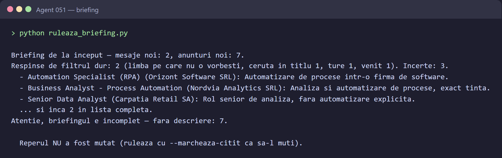
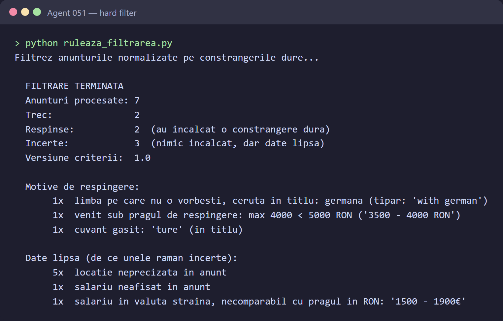

# Agent 051

Agent 051 reads job alert emails from Gmail (eJobs, BestJobs and LinkedIn, the main Romanian job
boards), checks every listing against your own criteria and tells you which ones are worth
opening. Job alerts arrive daily as dozens of listings per email, most of them off-target or
repeated; the agent sorts through all of them with the same rules every time and ends with a
short briefing of what is new and relevant.

## Screenshots

The briefing and the hard filter, on fictional example data (see [Example output](#example-output)):





## How it works

1. **Ingest** – emails are fetched over IMAP and stored raw (HTML and text) in SQLite.
2. **Extract** – each email is split into listings, with one parser per job board.
3. **Describe** – when an email only has the title, the description is read from the public
   job page (eJobs and BestJobs only; `robots.txt` is respected, with a pause between requests).
4. **Normalize** – a language model extracts a few facts from each listing (salary, work mode,
   location, languages).
5. **Filter** – hard constraints (salary, location, languages, excluded keywords) are
   deterministic rules in code, never model judgement.
6. **Evaluate** – the model rates only the listings that passed the filter, with a written reason.
7. **Brief** – the briefing is computed from the stored results, not written by the model.

Every step can be run from the command line or called as a tool through an MCP server, so a
personal assistant can ask for it. The author uses JA.S.Mine, a personal assistant built
alongside this project; any MCP client works.

> Code comments are in Romanian. So are identifiers, messages and configuration keys.

## Tech stack

- Python 3.14
- SQLite (standard library)
- IMAP for Gmail (standard library)
- [Anthropic API](https://docs.anthropic.com/) (`anthropic`) for normalization and evaluation
- [Model Context Protocol](https://modelcontextprotocol.io/) (`mcp`, with uvicorn and starlette)
  for the server
- `requests`, `PyYAML`, `python-dotenv`
- `unittest` for the tests (no real model or API key needed)

## Installation

You need Python 3.14, a Gmail account with IMAP enabled and an
[app password](https://support.google.com/accounts/answer/185833), and an Anthropic API key.

Windows:

```bat
git clone https://github.com/Mihai-Streanga/Agent051-public.git
cd Agent051-public
python -m venv .venv
.venv\Scripts\python.exe -m pip install -r requirements.txt
copy .env.example .env
```

macOS / Linux:

```bash
git clone https://github.com/Mihai-Streanga/Agent051-public.git
cd Agent051-public
python3 -m venv .venv
.venv/bin/python -m pip install -r requirements.txt
cp .env.example .env
```

Then fill in `.env` (see [Configuration](#configuration)) and adjust `config/criterii.yaml`.

Check that everything is in place:

```bat
.venv\Scripts\python.exe -m unittest discover -s tests
.venv\Scripts\python.exe verifica_gmail.py
```

The first command runs the tests (no keys needed). The second only connects to Gmail, lists the
folders and counts the emails; it does not read any email content.

## Usage

Run the steps in order, from the project folder (on macOS / Linux use `.venv/bin/python`).
The steps that call the model or the network show a dry run first and only do the work with
`--confirma`; `--limita N` caps how many listings are processed in one run.

```bat
.venv\Scripts\python.exe ruleaza_ingestia.py
.venv\Scripts\python.exe ruleaza_extragerea.py
.venv\Scripts\python.exe ruleaza_descrieri.py --confirma --limita 30
.venv\Scripts\python.exe ruleaza_normalizarea.py --confirma --limita 50
.venv\Scripts\python.exe ruleaza_filtrarea.py
.venv\Scripts\python.exe ruleaza_evaluarea.py --confirma --limita 50
.venv\Scripts\python.exe ruleaza_briefing.py
```

`ruleaza_briefing.py --marcheaza-citit` moves the "already read" marker, so the next briefing
only shows what arrived after it.

### Example output

The run below uses fictional data: two made-up BestJobs alert emails with seven listings from
invented companies, checked against the example criteria in `config/criterii.yaml`. The
extraction, filter and briefing output is real program output. The two model steps were run
with a **simulated model** (fixed answers passed in through the `cheama_model` parameter), so
the model's verdicts and reasons are illustrative, not answers from Claude.

Extraction – the emails are split into listings:

```text
Sparg mesajele in anunturi...

  EXTRAGERE TERMINATA
  Mesaje procesate: 2
  Mesaje reusite:   2
  Fara anunturi:    0  (din care NERECUNOSCUTE: 0)
  Incomplete:       0  (au iesit anunturi, dar nu toate joburile din link-uri)

  Anunturi extrase: 7  (cu tot cu repetari)
  Anunturi NOI:     7  (au intrat in baza)
  Deja existente:   0  (acelasi job, alt mail)

  MESAJE DIN CARE NU A IESIT NICIUN ANUNT:
  (niciunul)
```

Filter – hard constraints, deterministic rules in code:

```text
Filtrez anunturile normalizate pe constrangerile dure...

  FILTRARE TERMINATA
  Anunturi procesate: 7
  Trec:               2
  Respinse:           2  (au incalcat o constrangere dura)
  Incerte:            3  (nimic incalcat, dar date lipsa)
  Versiune criterii:  1.0

  Motive de respingere:
       1x  limba pe care nu o vorbesti, ceruta in titlu: germana (tipar: 'with german')
       1x  venit sub pragul de respingere: max 4000 < 5000 RON ('3500 - 4000 RON')
       1x  cuvant gasit: 'ture' (in titlu)

  Date lipsa (de ce unele raman incerte):
       5x  locatie neprecizata in anunt
       1x  salariu neafisat in anunt
       1x  salariu in valuta straina, necomparabil cu pragul in RON: '1500 - 1900€'
```

"Uncertain" is not "rejected": BestJobs emails carry no location per listing (it comes later,
from the job page), so these listings stay in and are marked as missing data.

Briefing – computed from the stored results:

```text
Briefing de la inceput — mesaje noi: 2, anunturi noi: 7.
Respinse de filtrul dur: 2 (limba pe care nu o vorbesti, ceruta in titlu 1, ture 1, venit 1). Incerte: 3.
  - Automation Specialist (RPA) (Orizont Software SRL): Automatizare de procese intr-o firma de software.
  - Business Analyst - Process Automation (Nordvia Analytics SRL): Analiza si automatizare de procese, exact tinta.
  - Senior Data Analyst (Carpatia Retail SA): Rol senior de analiza, fara automatizare explicita.
  ... si inca 2 in lista completa.
Atentie, briefingul e incomplet — fara descriere: 7.

  Reperul NU a fost mutat (ruleaza cu --marcheaza-citit ca sa-l muti).
```

The briefing warns that it is incomplete because the job page descriptions were not fetched:
the example listings are fictional, so there are no pages to read.

### MCP server

```bat
.venv\Scripts\python.exe porneste_mcp.py
```

The server listens on `http://<MCP_HOST>:<MCP_PORT>/mcp` and requires the header
`Authorization: Bearer <MCP_TOKEN>` on every request. Tools: `ingesteaza`, `extrage`, `descrie`,
`normalizeaza`, `filtreaza`, `evalueaza`, `briefing`, `oportunitati_noi`, `cauta`,
`stare_pipeline`.

On Windows, `porneste-agent051.vbs` starts the server hidden, with no console window; put a
shortcut to it in the Startup folder to start it at login.

## Configuration

`.env` (copied from `.env.example`):

| Variable | What to put there |
|---|---|
| `GMAIL_USER` | your Gmail address |
| `GMAIL_APP_PASSWORD` | a Gmail app password, not your account password |
| `GMAIL_FOLDER` | the Gmail label where your job alerts land (e.g. `Joburi`) |
| `ANTHROPIC_API_KEY` | your Anthropic API key |
| `MODEL_NORMALIZARE` | the model used for normalization and evaluation; must match `model` in `config/cost.yaml` |
| `MCP_HOST` | the address the server listens on (`0.0.0.0` = all interfaces, needed if the client runs in Docker) |
| `MCP_PORT` | the server port (default `8051`) |
| `MCP_TOKEN` | a long random secret; the server refuses to start without it. Generate one with `python -c "import secrets; print(secrets.token_urlsafe(32))"` |

`config/`:

- `criterii.yaml` – **your** search criteria: home city, remote/onsite rules, salary thresholds,
  languages you speak, excluded keywords, and the target role descriptions the model judges
  against. The values in this repository are fictional examples. If you put your real salary
  thresholds here, keep your copy private.
- `surse.yaml` – politeness settings for reading job pages (pause, timeout) and the User-Agent.
  Put your own contact address in `user_agent`.
- `cost.yaml` – model price per million tokens and your monthly budget, used for the cost report.

## Known limitations

- Only three sources, all Romanian job boards: eJobs, BestJobs and LinkedIn job alert emails.
  Each has its own parser, and a change in an email template breaks it until the parser is fixed.
- LinkedIn job pages are not read (LinkedIn blocks automated requests), so LinkedIn listings keep
  only the title, company and location from the email.
- Salaries are compared in RON per month. Salaries in another currency, or per hour or year, are
  marked as unknown rather than converted or rejected.
- Gmail only, via IMAP with an app password (no OAuth).
- No automatic schedule: every run is started by hand or by an MCP client.
- The model steps cost money (Anthropic API); `cost.yaml` sets the budget used by the cost report.
- The MCP server speaks plain HTTP; the token protects against other devices on the local
  network, not against traffic sniffing. Do not expose the port to the internet.
- Tested on Windows with Python 3.14.

## License

[MIT](LICENSE) © 2026 Mihai Streanga
